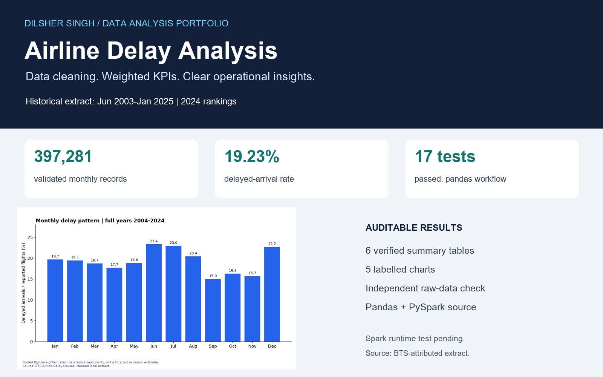
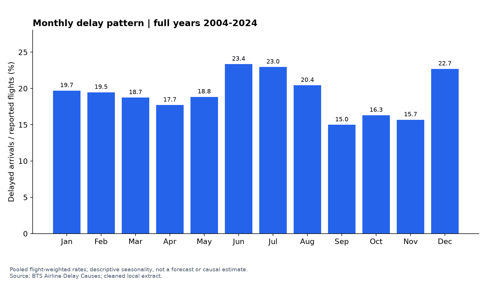

# Airline Delay Analysis | Python and PySpark

An auditable portfolio study of a BTS-attributed airline-delay extract, turning
monthly operational records into data-quality checks, weighted KPIs and visual reports.



## Results at a glance

| Measure | Result |
| --- | ---: |
| Raw monthly airline-airport records | 398,233 |
| Retained after validation | 397,281 |
| Records excluded for missing/invalid numeric values | 950 |
| Additional records excluded for negative measures | 2 |
| Flights represented in retained records | 143,786,417 |
| Delayed arrivals / reported flights | 19.23% |
| Cancellation rate | 1.88% |
| Average minutes per delayed arrival | 59.93 |

**Scope:** June 2003-January 2025. These are results for the retained records in
this supplied extract, not a claim of complete nationwide coverage.

## What the analysis shows

- Late aircraft account for 38.43% of attributed delay minutes,
  followed by carrier-related causes at 31.42%.
- Across full years 2004-2024, June has the highest pooled delay rate (23.36%),
  while September has the lowest (15.00%). These are descriptive patterns, not forecasts.
- Within the 2024 comparison, Frontier Airlines has the highest delay rate
  among qualifying carriers (28.03%). SFO has the
  highest among qualifying airports (29.50%). Both rankings
  require at least 100,000 reported flights in 2024 and do not control for route mix.



## Business question and deliverables

Where are delays concentrated, how do patterns vary by month, and which reported
causes account for the most delay minutes? The deliverables are six CSV summaries,
five labelled charts, an exclusion audit and a standalone visual case study.
Potential use: identify areas for deeper operational investigation. No realized
cost savings, airline recommendations or causal effects are claimed.

## Run locally

Use Python 3.13 for the recorded dependency set. The tested dependency
versions are recorded in `requirements.txt` (including Spark for the optional runtime).

```bash
python -m venv .venv
```

Activate on Windows PowerShell: `.venv\Scripts\Activate.ps1`.
On macOS/Linux: `source .venv/bin/activate`.

```bash
python -m pip install -r requirements.txt
python main.py --engine pandas
python -m pytest tests/test_pandas_engine.py -q
python tools/verify_exports.py
```

The full dataset is present in the local working copy, but excluded from the
publication ZIP and Git. See [data instructions](data/README.md). The included
sample is for a quick demonstration, not reproducing published results:

```bash
python main.py --engine pandas --data data/sample.csv --output sample_reports
```

### Spark execution

Install Java 17 or 21 and set `JAVA_HOME` to the JDK installation directory.
Use `java -version` to confirm your shell sees it. Spark's supported environment
is documented at https://spark.apache.org/docs/4.2.0/.

```bash
python main.py --engine spark --output spark_reports
python -m pytest tests/test_pipeline.py -q
```

Spark must be able to open a local Python-to-Java connection. If a restricted
session blocks that connection, use the tested pandas option. Do not change
system security controls just to run this project. For Windows temp-path issues,
choose an existing writable TEMP/TMP directory without special characters.

## Validation status

- **Passed:** 17 pandas tests, full-dataset execution and independent standard-library
  recomputation of all six tables (713 cells checked).
- **Not completed:** Spark runtime tests. This review environment blocked the
  local Java gateway connection (WinError 10013). The included reports were
  produced with pandas; they are not represented as verified Spark output.
- Source checksum, engine, periods and exclusions: [run metadata](reports/run_metadata.json).
- Independent comparison: [verification record](reports/verification.json).

## Project files

| Location | Purpose |
| --- | --- |
| `main.py` | Single CLI with Spark and pandas options |
| `pipeline/clean.py`, `pipeline/analyze.py` | Spark implementation |
| `pipeline/pandas_engine.py` | Tested local execution option |
| `pipeline/visualize.py` | Shared presentation charts |
| `tests/` | Data quality and analysis contract tests |
| `tools/verify_exports.py` | Independent verification against the original CSV |
| `reports/` | Published tables, charts, cover and validation records |
| `docs/Case_Study.html` | Standalone case study with embedded images |
| `docs/UPWORK_LISTING.txt` | Ready-to-edit portfolio description |

## Methodology, limitations and credit

Missing is not treated as zero. Complete-case exclusions can introduce bias.
The year chart marks 2003 and 2025 as partial; comparisons use 2024, and seasonality
uses full calendar years only. “Extreme weather” does not capture every weather
effect. Reporting scope, airline labels and coverage may change across years.
Read [methodology](docs/METHODOLOGY.md) and [source provenance](data/README.md).

Original project supplied by Dilsher Singh; this portfolio edition includes
AI-assisted refactoring, checking and documentation. It is an academic/personal
example, not a paid engagement. If the source was group coursework, credit the
collaborators and clarify personal contributions before publishing. No code
license is assigned here; confirm ownership and select one before inviting reuse.
