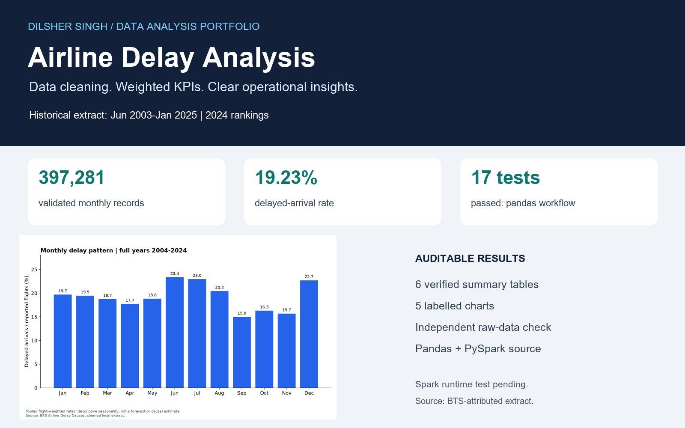

# Airline Data Analysis

**Portfolio project by Dilsher Singh**

Python airline data analysis project with data-cleaning and analysis modules, visualizations, exported reports, and tests.

## Explore the project

- [Full project README and setup instructions](Airline_Project_Portfolio/README.md)
- [Python source code](Airline_Project_Portfolio/pipeline)
- [Charts and exported reports](Airline_Project_Portfolio/reports)
- [Methodology](Airline_Project_Portfolio/docs/METHODOLOGY.md)
- [Data notes](Airline_Project_Portfolio/data/README.md)
- [Tests](Airline_Project_Portfolio/tests)

All project files are in the `Airline_Project_Portfolio` folder. Change into that folder before following the setup and run instructions.
